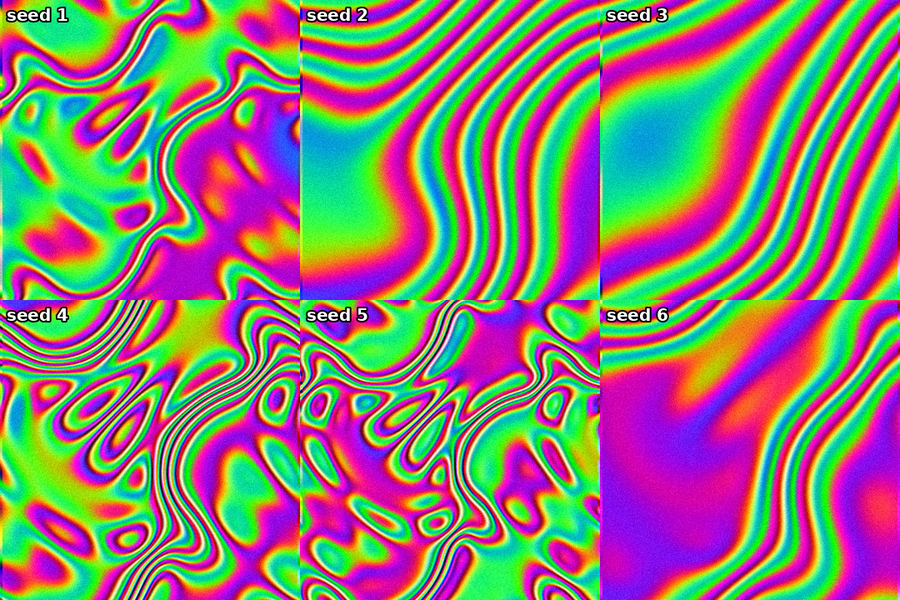
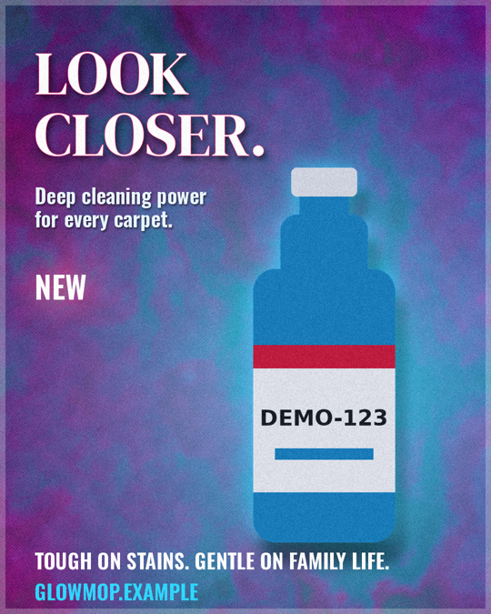

# funkbox

funkbox makes funky seamless looping videos and short vertical product ads on your own computer, driven by Claude
over MCP or from the command line. Procedural GPU shaders and a deterministic ad-reel engine do the work: no cloud,
no accounts, no API keys, no credits, and no NVIDIA GPU required. Drop a product photo, a logo and some music in a
folder, approve the exact wording once, and get a rendered ad whose on-screen text and voiceover are byte-identical
to what you approved.



*Six seeds of one funk2 shader recipe (`shaders/warp.frag`, chroma and grain post passes), rendered on a CPU-only box.*



*A v3.2 poster (`examples/stills/glowmop_poster.poster.json`): every word is drawn from the copy deck.*

## Quickstart (humans)

You need Python 3.10 or newer and git.

```bash
git clone https://github.com/IsraelWebDev/funkbox funkbox
cd funkbox
python install.py --with reel --register desktop --shortcuts   # Windows: py -3 install.py ...
```

Quit Claude Desktop before `--register desktop` and start it again afterwards. `--register code` connects Claude
Code instead; `--dry-run` prints the plan without changing anything; `--unregister` removes funkbox's entries
again. Then ask Claude for "a funky looping video", or "make an ad": create a project, drop your files in the
`funk inbox` folder, approve the proposed copy, and render.

Without Claude: `python funk2.py render --shader shaders/warp.frag --seconds 4 --size 540` and
`python reel_cli.py --help`.

**For AI agents: see [AGENTS.md](AGENTS.md)** (copy-pasteable install, verify and uninstall steps for Windows,
macOS and Linux) and [skills/funk-studio/SKILL.md](skills/funk-studio/SKILL.md) (how to drive the servers).

## What is in the box

| version | what | entry points |
|---|---|---|
| v1 | CPU-only seamless loops (MP4, GIF, PNG) from math | `funk.py`, `funk_mcp.py` |
| v2 | GPU shader engine: GLSL layers, recipes, post passes, audio reactivity, tiling, 3D-ish blobs | `funk2.py`, `funk2_mcp.py` |
| v3 | "reel": JSON shot list plus an approved copy deck to a 9:16 ad: parallax product shots, captions, end card, beat-synced music, local voiceover, text audit | `reel_cli.py`, `reel_mcp.py` |
| v3.1 | "projects": inbox ingest, product cut-out with a quality score, brand colours from the product, copy proposal and user approval with a hash lock, automatic reel | `projects/<name>/`, same tools |
| v3.2 | "stills": layered posters and photo edits on the GPU: exact text from the copy deck, variations, OpenRaster export for GIMP | `stills_cli.py`, `stills_mcp.py` |
| studio | optional on-demand FastSD CPU text-to-image and a GIMP 3 MCP bridge | `studio/studio_mcp.py`, `install.py --with fastsd,gimp` |

The copy guarantee: Claude may only propose wording (`propose_copy`). Only the user's approval writes the real
`copy.json`, and the validator refuses any reel whose copy no longer matches the approved hash. Details in
[docs/reel.md](docs/reel.md).

**Demo ad:** [`examples/mimic/`](examples/mimic/) is a 20-second vertical carpet-cleaner ad for a fictional brand. Its scenes came from FastSD, the product is drawn procedurally, the music is synthesized, and it was rendered on an Intel Iris Xe laptop in about 2 minutes. [preview.mp4](examples/mimic/preview.mp4), [storyboard](docs/mimic-storyboard.png).

## Hardware

Any machine with OpenGL 3.3 works, including Intel integrated graphics; software rendering (Mesa llvmpipe) works
for headless boxes (`FUNK_GL_BACKEND=egl`). Depth estimation runs on the CPU (ONNX). FastSD runs on an Intel iGPU
through OpenVINO or on the CPU. Roughly 4 GB of free RAM is enough for the optional image generator.

## Documentation

- [docs/v1-v2.md](docs/v1-v2.md): loops, shader contract, recipes, knobs, adding an effect, tests
- [docs/reel.md](docs/reel.md): the ad engine, the projects flow, the copy lock
- [docs/stills.md](docs/stills.md): posters, edits, variations, OpenRaster
- [docs/studio.md](docs/studio.md): FastSD and GIMP on demand
- [AGENTS.md](AGENTS.md): installation for agents and humans
- [THIRD_PARTY_NOTICES.md](THIRD_PARTY_NOTICES.md): licences of everything funkbox uses or downloads

## Tests

```bash
pip install -r requirements.txt pytest
FUNK_GL_BACKEND=egl pytest -q        # leave the variable out when a GPU driver is present
```

## License

MIT, see [LICENSE](LICENSE). Optional components keep their own licences (GPL-3.0 for piper-tts and gimp-mcp,
which are installed on request and not bundled).
