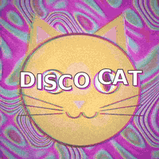
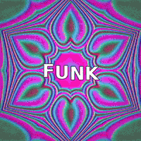
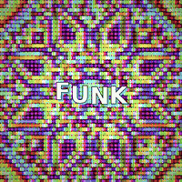
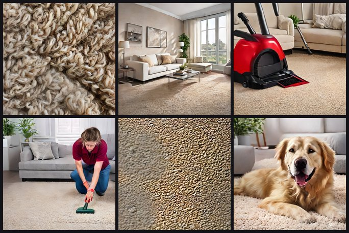
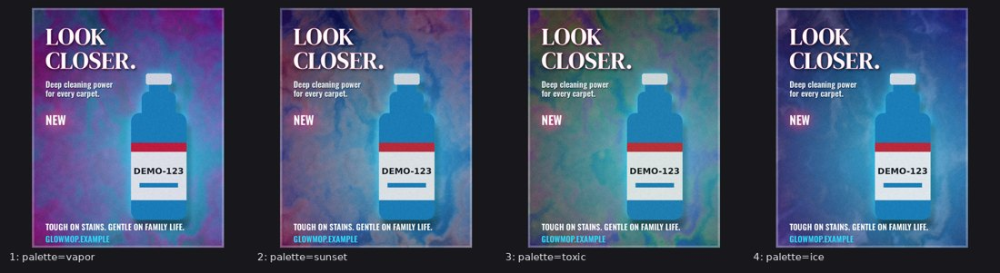

# funkbox

funkbox makes funky seamless looping videos, posters, AI-generated scenes and short vertical product ads on your
own computer, driven by Claude over MCP or from the command line. Procedural GPU shaders and a deterministic
ad-reel engine do the work: no cloud, no accounts, no API keys, no credits, and no NVIDIA GPU required. Drop a
product photo, a logo and some music in a folder, approve the exact wording once, and get a rendered ad whose
on-screen text and voiceover are byte-identical to what you approved.

<table><tr>
<td width="25%"></td>
<td width="25%"></td>
<td width="25%"></td>
<td width="25%"></td>
</tr></table>

*Everything on this page was rendered locally: the ad on an Intel Iris Xe laptop, the loops on a CPU-only Linux box.*

## What to ask Claude

Once funkbox is connected (see the Quickstart), you talk to Claude in plain words. Each example below shows the
kind of prompt that produces it, and the files that hold the exact result.

### A seamless loop from a photo

> Make a 4-second seamless loop of examples/cat.png: put the cat on a vapor-coloured warp background, add a
> soft feedback echo and some blobs, wobble the words "DISCO CAT" over it, then finish with chromatic aberration,
> a vignette and film grain. Show me a preview frame before rendering.

Recipe: [`examples/disco_cat.json`](examples/disco_cat.json). Claude previews a frame (`loop_preview`), renders
(`loop_render`), and every loop is checked automatically so the last frame flows into the first.

### A loop from a named look

> Show me the loop presets, then render liquid-disco with the word FUNK, and a party-poster one with seed 5.
> Square, 4 seconds.

Eight presets ship (`python -m funkbox loop list`). Ask for tweaks in words ("more kaleidoscope", "toxic
palette", "less grain") and Claude turns them into overrides like `kaleido=8 palette=toxic`.

### Photos from a description (FastSD, on the iGPU)



> Start the image generator. Then generate square photorealistic scenes for a carpet-cleaner ad, no text or
> logos: an extreme macro of beige wool carpet fibers, a bright modern living room with beige carpet, a red
> carpet extractor on the carpet, a cleaner in a maroon polo working with a wand, a coffee stain close-up, and a
> golden retriever lying on clean carpet. Two seeds each, then upscale the best ones 2x.

These are the six used in the demo ad (the exact prompts are in [`examples/mimic/README.md`](examples/mimic/README.md)).
Once the model is warm, SD-Turbo makes a 512x512 image in seconds on an Intel iGPU (the first run at a new size compiles for a few minutes). `image_restyle` re-renders a picture in a new
style, and `image_edit` handles crops, adjustments and text without AI.

### A poster with exact text, in four colourways



> Make an Instagram portrait poster for the GLOWMOP bottle in examples/stills: a flowing shader background, the
> bottle with a glow behind it, the headline and claim from the copy deck. Then give me four versions with the
> vapor, sunset, toxic and ice palettes side by side, and export my favourite as layers for GIMP.

Poster: [`examples/stills/glowmop_poster.poster.json`](examples/stills/glowmop_poster.poster.json). Every word comes
from the copy deck, so variations never misspell anything. `poster_export_ora` writes an OpenRaster file whose
layers open separately in GIMP.

## The demo ad, start to finish

[`examples/mimic/`](examples/mimic/) is a 23-second vertical (1080x1920) ad for **GLOWMOP**, a fictional carpet
shampoo, built to mimic the rhythm of a real social product ad. Watch [preview.mp4](examples/mimic/preview.mp4)
(with sound) or the [storyboard](docs/mimic-storyboard.png).

- **What's in it:** 12 cuts snapped to a 110 BPM beat. Captions in red boxes type on. The product is composited
  into three shots with a contact shadow, and the voiceover ducks the music. A split end card shows the brand.
- **How it was made:**
  - the scenes are the FastSD images above;
  - the bottle is drawn by code, so its label is exact;
  - the music is synthesized;
  - the voice is local text-to-speech (Kokoro by default, Piper as the fallback);
  - rendering took about 3.5 minutes on an Intel Iris Xe laptop.

A conversation that builds an ad like this:

> **1.** Start a new ad project called GLOWMOP. I'll drop the product shot, the logo and a music track in the inbox.
>
> **2.** (files dropped) Ingest them, cut out the product, and pick brand colours from the logo.
>
> **3.** Propose copy for a 20-second ad: a hook that makes people look closer at their carpet, "Meet GLOWMOP
> Deep Clean", one line about deep stains, one about being safe for wool, kids and paws, and an end card that
> says Deep Clean Glow, PRO RESULTS AT HOME, GLOWMOP.EXAMPLE. Voiceover on every caption.
>
> **4.** Change the hook to "LOOK CLOSER. SEE WHAT'S HIDING?" and approve.
>
> **5.** Build a fast shot list with red-box captions using my scenes, keep the product out of the captions' way,
> and show me the storyboard.
>
> **6.** Render it.

Claude can only *propose* wording. The approved lines are locked by a hash, and the renderer refuses anything that
changed since you approved it. That is why the captions and the voiceover match your words exactly. The
[demo's README](examples/mimic/README.md) lists where every asset came from and what the engine can't do yet
(real motion of people needs an NVIDIA GPU; drop in clips from any video generator instead).

## Quickstart (humans)

You need Python 3.10 or newer and git.

```bash
git clone https://github.com/IsraelWebDev/funkbox funkbox
cd funkbox
python install.py --with reel --register desktop --shortcuts   # Windows: py -3 install.py ...
```

- **Claude Desktop:** quit it before `--register desktop` and start it again afterwards.
- **Image generation and GIMP:** add `fastsd,gimp` to `--with`.
- **Other flags:**
  - `--register code` connects Claude Code instead;
  - `--dry-run` prints the plan without changing anything;
  - `--unregister` removes funkbox's entries again.

Without Claude there is one command line: `python -m funkbox loop render --preset liquid-disco --text FUNK`,
`python -m funkbox --help` (or `python funkbox.py ...` from a checkout). Upgrading from v3? See
[docs/migration-v4.md](docs/migration-v4.md).

**Claude Code plugin** (needs `uv`; the reel models and FastSD still come from `install.py`):
`/plugin install funkbox --marketplace IsraelWebDev/funkbox`

**For AI agents: see [AGENTS.md](AGENTS.md)** (copy-pasteable install, verify and uninstall steps for Windows,
macOS and Linux) and [skills/funk-studio/SKILL.md](skills/funk-studio/SKILL.md) (how to drive the tools).

## What is in the box

One package (`funkbox/`), one command line (`python -m funkbox`) and one MCP server (`funkbox`, 42 tools).

| area | what | command / tools |
|---|---|---|
| loops | GPU shader engine: GLSL layers, recipes, post passes, audio reactivity, tiling, a machine check that every loop is seamless, and eight preset looks | `funkbox loop ...`, `loop_*` |
| reel + projects | a JSON shot list plus an approved copy deck become a 9:16 and/or 16:9 ad (parallax shots, screen recordings with push-ins and speed ramps, captions, end card, cuts on a beat grid, local voiceover, text audit). Projects add: inbox ingest, product cut-out, brand colours, copy approval with a hash lock, and an automatic shot list | `funkbox reel ...`, `funkbox project ...`, `reel_*`, `project_*` |
| posters + images | layered posters and photo edits with exact text: shapes, SVG import, clipping, letter spacing, styled runs, text on any path; variations, one design in many sizes, animated posters (MP4), SVG/PDF vector export, OpenRaster for GIMP, scoring against a reference picture, tracing a logo into vectors; FastSD text-to-image, img2img and upscale | `funkbox poster ...`, `funkbox image ...`, `poster_*`, `image_*` |
| music | short scores played by sampled General MIDI instruments (a numpy SoundFont player), usable as a reel's music with its beat grid | `funkbox music ...`, `music_render` |
| apps | on-demand FastSD CPU image model and a GIMP 3 MCP bridge | `funkbox apps ...`, `apps_*`, `install.py --with fastsd,gimp` |

`python -m funkbox doctor` prints the resolved settings and what was found (GL, ffmpeg, models, apps).

## Hardware

- **Graphics:** any machine with OpenGL 3.3 works, including Intel integrated graphics. Headless boxes can use
  software rendering (Mesa llvmpipe, `FUNK_GL_BACKEND=egl`).
- **Depth estimation:** runs on the CPU (ONNX).
- **FastSD:** runs on an Intel iGPU through OpenVINO, or on the CPU. About 4 GB of free RAM is enough.

## Documentation

- [docs/loops.md](docs/loops.md): loops, shader contract, recipes, presets, adding an effect
- [docs/reel.md](docs/reel.md): the ad engine, the projects flow, the copy lock
- [docs/stills.md](docs/stills.md): posters, edits, typography, variations, sizes, motion, SVG/PDF, OpenRaster, tracing, comparing
- [docs/music.md](docs/music.md): scores, instruments, music for reels
- [docs/studio.md](docs/studio.md): FastSD images and GIMP on demand
- [docs/migration-v4.md](docs/migration-v4.md): old scripts and tool names to the new ones
- [AGENTS.md](AGENTS.md): installation for agents and humans
- [promo/](promo/README.md): how funkbox promotes itself: a scheduled agent makes a daily Short with funkbox, a
  second agent reviews it, and it posts to YouTube and X
- [docs/history/](docs/history/): plans, hand-offs and build reports of earlier versions
- [PRIVACY.md](PRIVACY.md): what funkbox reads, writes and sends (nothing)
- [THIRD_PARTY_NOTICES.md](THIRD_PARTY_NOTICES.md): licences of everything funkbox uses or downloads

## Tests

```bash
pip install -r requirements.txt pytest
FUNK_GL_BACKEND=egl pytest -q        # leave the variable out when a GPU driver is present
```

## License

MIT, see [LICENSE](LICENSE). Optional components keep their own licences (GPL-3.0 for piper-tts, espeak-ng used by kokoro-onnx, and gimp-mcp,
which are installed on request and not bundled). FastSD images are covered by the Stability AI Community License
(see [THIRD_PARTY_NOTICES.md](THIRD_PARTY_NOTICES.md)).
