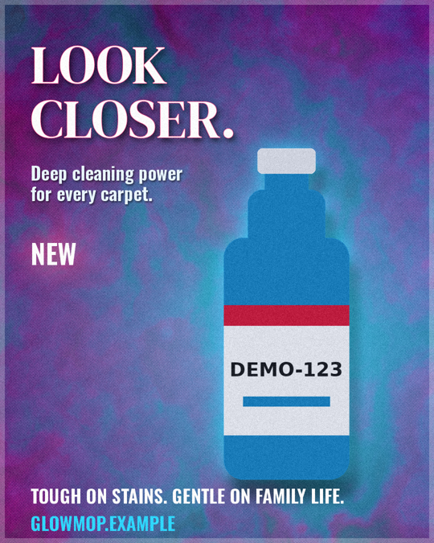

# Posters and photo edits

`funkbox poster ...`, `funkbox image edit ...` and the `poster_*` / `image_edit` MCP tools render a JSON poster
(`*.poster.json`) or edit a photo on the GPU you already use for loops. Layers are rasterised on the CPU, filtered and composited on the GPU with the same blend modes as the loop engine, and
text is drawn by funkbox from the copy deck, never by an image model.



```
python examples/stills/make_assets.py                                   # synthetic bottle + carpet texture
python -m funkbox poster preview examples/stills/glowmop_poster.poster.json -o out/pv.png
python -m funkbox poster render  examples/stills/glowmop_poster.poster.json --name glowmop
python -m funkbox poster vary    examples/stills/glowmop_poster.poster.json --vary '{"seed":[1,2,3,4]}'
python -m funkbox image edit     photo.jpg --ops '[{"op":"crop","aspect":"1:1"},{"op":"adjust","contrast":0.2}]'
python -m funkbox loop still --shader shaders/warp.frag --canvas story --t 0.3
python -m funkbox poster export-ora examples/stills/glowmop_poster.poster.json   # layers for GIMP / Krita
```

## MCP tools

| tool | does |
|---|---|
| `poster_presets()` | canvas presets, layer types, blends, filters, effects, export formats, edit ops |
| `poster_preview(poster, max_side=720)` | small render with the same layout and text, writes nothing: look before you render |
| `poster_render(poster, name)` | full render to `out/posters/` (a project poster goes to `projects/<p>/out/`): PNG (or JPG/WebP/ORA/SVG/PDF per `export.formats`), `<name>.poster.json` sidecar, `<name>.text_audit.json` |
| `poster_variations(poster, vary, name)` | up to 12 variants and a labelled contact sheet |
| `image_edit(path, ops, name)` | non-destructive edit of a copy; writes `out/edits/<stem>-<n>.png`, a sidecar and a before/after sheet |
| `loop_still(recipe_or_shader, t, preset)` | one frame of a loop recipe or shader as a poster background |
| `poster_export_ora(poster, name)` | the poster as a layered OpenRaster file plus the PNG |
| `poster_sizes(poster, sizes, name, fit_to, formats)` | the same poster for other canvases (`story`, `landscape`, ... or `{name, width, height, set}`), each with its own text audit, plus a sheet |
| `image_trace(path, name, colors, palette, smooth, tolerance, lift_text, max_letter, texts, font)` | a picture traced into a vector SVG of flat colours (`out/traces/<name>.svg`), with a fidelity score; place it as an `svg` layer. `lift_text` takes the lettering out and returns its lines; with `texts` also a starter poster with live text |
| `poster_animate(poster, name, scale, gif)` | the poster's `motion` block as `<name>.mp4` (+ GIF), the last frame (the poster) as PNG, six frames on a strip and a per-frame text audit |
| `poster_fit(poster, reference, params, keep_inside)` | tunes the poster's numbers (positions, sizes, points) to raise its `poster_compare` score against a reference; `keep_inside` keeps words inside their part of the artwork |
| `poster_fit_inside(poster, specs)` | sizes and places text layers so their words fit inside a bar, plate or label of the artwork, as large as fits, with a margin |
| `poster_compare(candidate, reference, name, fit)` | scores a render (picture or poster) against a reference picture: overall, structure, colour, layout (0..100), the most different regions of a 4x4 grid, unmatched reference colours, and a candidate / reference / heat-map sheet |

`poster` is a JSON object or a path to a `.poster.json` inside `FUNK_HOME`, `FUNK_OUT`, `FUNK_INPUTS` or the projects
folder. Errors come back as `ERROR: ...` text listing every problem found.

## The poster document

```json
{ "version": 1, "name": "x", "canvas": {"preset": "insta-portrait", "background": "#0b1030"},
  "copy": "glowmop.copy.json", "brand": {"primary": "#ff3d7f", "secondary": "#2fd6ff", "text": "#ffffff"},
  "seed": 11, "layers": [ ... ], "post": [{"name": "grain", "amount": 0.04}],
  "export": {"formats": ["png", "ora"], "jpg_quality": 92} }
```

`brand` may also set `font_caption`, `font_display` and `font_fallback`, each a .ttf/.otf path or a Google Fonts name
such as `"Rubik:800"` (fetched once, then offline). Text in any script works when its font has the glyphs: a missing
glyph is an error naming the character, and the fallback (default: the bundled Rubik Bold, with Hebrew and
Cyrillic) draws a text layer the main font cannot. Hebrew and other right-to-left text is laid out right to left; use
`"align": "right"` for right-aligned blocks. See "Fonts by name" in docs/reel.md.

Canvas: a preset (`square` 1080x1080, `insta-portrait` 1080x1350, `story` 1080x1920, `landscape` 1920x1080, `twitter`
1600x900, `a4-150dpi` 1240x1754) or `width`/`height` (64..4096, rounded to even). `background` is a colour or
`"transparent"` (PNG/WebP keep the alpha, JPG goes over white).

Layers (bottom first; every layer takes `blend`, `opacity`, `mask`, `adjust`, `filters`, `visible`, and `clip`: the id
of a shape or svg layer to show this layer only inside, often an invisible one used just as the outline):

| type | keys |
|---|---|
| `image` | `path`, `fit` cover/contain/stretch, `x`, `y`, `scale`, `rotate_deg`, `pre` (crop, resize, rotate, flip, remove_background, trim_even) |
| `solid` | `color` (`#rrggbb[aa]` or `brand.primary|secondary|text`) |
| `gradient` | `stops`, `kind` linear/radial, `angle`, `cx`, `cy`, `radius`, `dither` |
| `shader` | one of `shader` (.frag path), `source` (GLSL), `recipe` (loop recipe or path); `t` (0..1), `palette`, `cycles`, `params`, `seed`. A recipe that draws its own text is refused |
| `product` | `image` (PNG with alpha), `x`, `y` (bottom centre), `height`, `shadow`, `match_color`, `effects`. Same compositor as the reel: the product's pixels are composited, never regenerated |
| `text` | `copy_id` or `text`, `style` display/caption, `size`, `x`, `y`, `max_width`, `color`, `align`, `line_height`, `effects` (shadow, stroke, glow); `wrap: false` (one line, shrunk to fit `max_width`); geometry: `arc` (bend along a circle: radius in canvas widths, + a smile, - a frown), `skew_x`, `skew_y` (slant, degrees), `rotate_deg` |
| `shape` | `kind` polygon/rect/ellipse/polyline/path, `points` (`[x, y]` canvas fractions; rect and ellipse take two corners), `fill`, `stroke` + `stroke_px` (an outline outside the shape), and for a polyline `width` (fraction of the canvas width) and `cap` square/butt: a thick bar with mitred corners, for ribbons and block lettering. `kind: path` takes `d`, SVG path data (M L H V C S Q T A Z, curves and arcs), in canvas fractions or with `units: px` in canvas pixels, and `fill_rule` nonzero (default) or evenodd |
| `svg` | `path` to an .svg file, `x`, `y` (top-left), `width` (canvas fractions; `height` follows its viewBox unless given). Paths, rects, circles, ellipses, lines, polygons, groups with transforms, fill/stroke/opacity; a gradient fills with its first colour; `<text>` is skipped with a warning (convert text to outlines first) |
| `group` | `layers` (flattened, then blended as one layer; nesting up to 8) |
| `border` | `px`, `color` |

Text geometry is applied after the text is laid out and shaped, so letters, kerning and right-to-left order are
untouched and the text audit still checks the exact string; the audit entry records the `geometry` used. A ribbon
and the text on it line up when the ribbon's polyline follows the same circle as the text's `arc` (see
`examples/stills/badge.poster.json`: a shield, a slanted band, block strokes, Hebrew, and arched text).

`adjust`: brightness, contrast, saturation, hue, levels `[black, white, gamma]`, temperature, invert. `filters`: blur,
sharpen, posterize, halftone, duotone `[dark, light]`, pixelate, chroma, vignette. Masks: `radial`, `linear`, `image`
(with `feather`, `invert`). `post`: the loop post passes (grain, vignette, chroma, halftone, posterize, scanlines).

## Text is exact

* **Project posters** (`"project": "<name>"`): text layers use `copy_id` only, against the project's approved
  `copy.json`. A literal `text` is rejected even in a casual document, and a copy deck that changed since approval is
  refused (same hash lock as the reel).
* **Other posters**: `copy_id` needs a `"copy"` deck; a literal `text` layer needs `"casual": true`.
* Every render writes `<name>.text_audit.json`: for each text layer the source, the drawn lines reconstructed from the
  layout, and whether they equal the source byte for byte. Text that does not fit at the minimum size is an error, not
  a silent shrink.

## Variations

`vary` maps a key to a list of values: `seed`, `layers.<id>.<property...>` (e.g. `layers.bg.palette`,
`layers.photo.adjust.hue`), `canvas.<k>`, `post.<n>.<k>`. Several keys are zipped and must have equal length; at most
12 variants. Every variant is validated before any is rendered, and gets its own sidecar.

## Edits

`image_edit` never writes the source: it builds a one-image poster, renders it, and writes `<stem>-<name|n>.png` (n
counts up, nothing is overwritten) with the sidecar that re-renders it to the same pixels. Ops run in order and
geometry ops (`crop` with `aspect` + `anchor` or `x,y,w,h`; `resize`; `rotate`; `flip`; `remove_background`;
`trim_even`) come first. Then `adjust`, `filter`, `vignette`, `overlay {path, x, y, scale, blend, opacity}`,
`text {copy_id|text}` and `border`. `remove_background` uses the reel's cut-out and reports its quality score.

## OpenRaster

`.ora` is a zip GIMP and Krita open with the stack intact: `mimetype` first and stored, `stack.xml` (top layer first,
with blend and opacity), one PNG per layer, a thumbnail and `mergedimage.png`. Layers are pre-rendered with their
adjustments, filters, effects and masks; blend modes map to `svg:src-over`, `svg:multiply`, `svg:screen`, `svg:plus`,
`svg:overlay`, `svg:difference`, `svg:soft-light`, `svg:hue`. A group is one flattened layer. Poster-level `post`
passes cannot be layers, so they appear only in the PNG/JPG, not in the `.ora` (`mergedimage.png` is the stack
without them). `funkbox poster ora-check FILE` validates a file.

## Typography

Text layers take three more keys, and keep the exactness guarantee (the words themselves never change; the audit
records them and the typography used):

- `letter_spacing` (ems, -0.2..1): extra space after every letter but the last, for tracked-out headings.
- `runs`: style some words inside one block: `[{"match": "Hashem", "font": "display", "color": "#d4202c",
  "scale": 1.2}]`. `font` is `display`, `caption`, a font name (`"Frank Ruhl Libre:700"`, fetched like brand fonts) or
  a file; every occurrence is styled unless `"all": false`. A run that matches nothing, or whose font lacks a letter,
  is an error naming it.
- `on_path`: set one line along SVG path data (canvas fractions, or `"path_units": "px"`): a curve, a wave, a circle
  (`M cx,cy+R a R,R 0 1,1 0.1,0`). Letters stand on the left of the direction of travel, so a clockwise circle reads
  around its outside. `align` places the line on the path, `path_offset` (0..0.95) moves its start, `path_shift` (ems)
  lifts the baseline. Too long for the path, it shrinks like any other text.

These are drawn from HarfBuzz-shaped glyph outlines (the same geometry the SVG/PDF export writes). Inside one line,
mixed right-to-left and left-to-right pieces follow the paragraph's direction; keep such a line in one run.

## Lettering

Some lettering is drawn rather than set in a font: block letters made of bars, emblem monograms. funkbox builds such
letters into a real font file, so the words are still typed, shaped (Hebrew right to left), checked for missing
letters and audited like any other text; only the shapes are drawn.

- `"font": "Funkbox Block:800"` on a text layer (or in a run, or as a brand font) uses the built-in geometric block
  face: every Hebrew letter and final form, geresh and gershayim, Latin capitals (lowercase is drawn as capitals),
  digits and common punctuation. The weight (100..900) sets the bar thickness.
- A poster can draw its own letters in `"glyphs"` and use them with `"font": "glyphs:<name>"`:

```json
"glyphs": {"emblem": {"base": "block", "weight": 800, "chars": {
  "צ": {"width": 0.9, "strokes": [[[0.1, 0.1], [0.1, 0.46], [0.8, 0.9]], [[0.8, 0.1], [0.8, 0.34], [0.5, 0.58]]]},
  "ה": {"width": 0.85, "d": "M0,0 L0.85,0 L0.85,1 L0.67,1 L0.67,0.18 L0,0.18 Z M0,0.42 L0.18,0.42 L0.18,1 L0,1 Z"}}}}
```

  Coordinates are in a box one cap height tall: x from 0 to `width`, y from 0 (top of capitals) to 1 (baseline),
  past 1 for descenders and below 0 for ascenders; a glyph may reach outside its box (overlapping letters, a long
  foot). `strokes` are centrelines drawn as bars `weight` thick with square ends and mitred corners (repeat the first
  point to close one); `d` is filled SVG path data. With `"base": "block"` the set starts from the block face and
  redraws only the letters given. Combine with `skew_y`, `effects.stroke` and `runs` for slanted, outlined emblem
  lettering. A letter the font lacks is an error, never an empty box.

## Fitting to a reference

`poster_fit(poster, reference, params)` (CLI: `funkbox poster fit X.poster.json ref.png --params '{...}'`) tunes the
numbers you name until `poster_compare`'s overall score stops rising. Keys are variations keys and can reach into
lists (`"layers.band.points.2.1": 0.01` moves the third point's y); give a step or a `[low, high]` range. The search is
coordinate descent with a shrinking step on small previews (layers a candidate did not change are reused); every
candidate is validated, and text, ids, files and path data are never parameters. It writes `<name>.fit.poster.json`.
Get the design right first (shapes, lettering, colours); fitting closes the last few points.

## SVG and PDF

Add `"svg"` and/or `"pdf"` to `export.formats` for files that stay sharp at any size (print, signage, a cutter).
Solids, borders, gradients, shapes, imported SVGs and text are written as vector paths. Text is shaped with HarfBuzz
(the same shaping as the pixel render: kerning, ligatures, right-to-left) and saved as glyph outlines, so the file needs
no fonts and carries exactly the approved words; `arc`, `skew_x/y` and `rotate_deg` bend the outlines themselves.
Layers that are pixels (image, product, shader, group) or that `adjust`, `filters`, a `mask`, or a text `shadow`/`glow`
turned into pixels are embedded as pictures in place, and the render's warnings name them. Blend modes become CSS
`mix-blend-mode` in SVG and PDF blend modes (`add` has no PDF equivalent); poster-level `post` passes are pixel-only.
The PDF page is the canvas at 96 dpi (a 1080 px poster is 11.25 in wide). From Python:
`funkbox.stills.vector.export(rendered, "poster.pdf")` returns which layers are vectors and which are pictures.

## Animated posters

A `motion` block makes the poster move; `poster_animate` (CLI: `funkbox poster animate X.poster.json`) renders it.
Animations run towards the document's values, so the last frame is the poster and `poster_render` still gives the
still.

```json
"motion": {"seconds": 6, "fps": 30,
  "enter": [{"layer": "title", "effect": "rise", "at": 0.3, "dur": 0.8}, {"layer": "logo", "effect": "pop", "at": 1}],
  "tracks": {"layers.title.letter_spacing": [[0, 0.4], [1.5, 0.05, "out"]],
             "layers.halo.opacity": [[0, 0.2], [3, 0.8, "inout"], [6, 0.2, "inout"]]},
  "loop_shaders": true}
```

`enter` effects: `fade`, `rise`, `drop`, `slide-left`, `slide-right`, `pop` (backgrounds can only fade). `tracks` keyframe
any property the variations keys reach, plus `dx`, `dy` (move, canvas fractions) and `scale` (about the layer's centre)
for text, shape, svg, product, image and group layers. Keyframes are `[seconds, value]` or `[seconds, value, ease]`
(`linear`, `in`, `out`, `inout`); numbers, lists of numbers and `#rrggbb` colours interpolate. Shader layers run
one full loop over the video (`loop_shaders`). Layers that do not change between frames are drawn once and reused.
Text is never typed out letter by letter: every frame draws the whole approved text and is audited
(`<name>.motion_audit.json`). Use `scale: 0.5` for a fast draft.

## One poster, many sizes

`poster_sizes` (CLI: `funkbox poster sizes X.poster.json --sizes story,landscape,square`) redraws a poster for other
canvases without distorting it. Backgrounds (`solid`, `gradient`, `shader`, `border`, `image`) stretch to the new
canvas; text, shapes, SVGs and products keep their proportions: the design is scaled to fit and centred, so circles
stay round and text keeps its size relative to the design. A layer's `"resize"` overrides that: `fill`, `fit`, or pinned
to an edge or corner (`top`, `bottom`, `left`, `right`, `top-left`, ...), so a footer band stays at the bottom of a
story. `fit_to: "content"` fits only the drawn foreground (plus a margin) so a wide banner or a tall story uses its
space. A size can carry its own fixes in the variations' keys, in the new canvas's fractions:
`{"name": "story", "width": 1080, "height": 1920, "set": {"layers.title.y": 0.12}}`. Every size is checked and
audited on its own; one whose text would not fit is reported while the rest render.

### Words inside a bar or plate

Fitting to a reference copies the reference's flaws: if its English runs past the end of its bar, so will the fit.
`poster_fit_inside` (CLI: `funkbox poster fit-inside X.poster.json --specs '[...]'`) sizes and places text layers so
the words stay inside a part of the artwork instead. A spec is `{"layer": "eng", "at": [x, y], "band": 0.05,
"margin": 0.003}`: `at` is a point (fractions of the canvas) on the part the words belong in; the region is the
connected area of that artwork colour around it, taken from the layers under the text (`tolerance` sets how close a
colour counts, default 60). `band` cuts the region to a strip of that half-thickness (a fraction of the canvas
height) along the layer's own `skew_y` angle, so a slanted bar that joins a bigger shape of the same colour stays a
bar. The words come out as large as they fit, `margin` clear of the edge and centred (`equal_size`, the default,
gives several layers the smallest of their sizes, for the two halves of one phrase). It sets only `size`, `x` and
`y` (and align left, no wrap); the words are never touched, and bent text (`arc`, `on_path`) is refused. Pass the same
specs to `poster_fit` as `keep_inside` and any candidate whose words leave their region is rejected, so the last
points of a fit cannot push them out. On the emblem's two slanted bars, a condensed italic fitted this way came out
about 40% larger than the regular italic placed by eye.

## Tracing a picture into vectors

`image_trace` (CLI: `funkbox image trace logo.png`) turns a logo, emblem or flat illustration into an SVG of a few flat
colours that stays sharp at any size, can be recoloured by editing the file, and drops into a poster as an `svg` layer
(or a `clip`). The picture is reduced to its main colours (k-means in Lab, or exactly the `palette` you give, which is
best when you know the brand colours), specks are smoothed away, every colour region is traced along its pixel edges
(holes included), simplified to `tolerance` pixels and, with `smooth`, curved between its corners; long straight
edges stay straight. Colours are stacked largest first, each extended under the ones drawn over it, so no hairline gaps
show. The fidelity score is `poster_compare` of the trace against the original. Photos trace into posterised art.

### Lifting the lettering out (artwork + live text)

Traced lettering is only pixels in vector form: it can't be edited, audited or set in another language. `lift_text`
separates it. Give the text colours (`["#1b224b", "#3e61ad"]`; `{"color": "#d9ba6a", "within": [x, y, w, h]}` looks only
in that part of the picture, as fractions, when the same colour also appears in the art; or `"auto"`). Letter-sized
shapes of those colours (and their shades; no side over `max_letter`, default 0.12 of the picture) are painted over
from their surroundings, so gradients carry on smoothly, and the artwork is traced without them. Their lines come back
as boxes, top to bottom: colour, box `[x, y, w, h]` in picture pixels, angle (for slanted lines) and the number of
letters, also written as `<name>.text.json`.

With `texts` (the words of each line, top to bottom) a starter poster `<name>.poster.json` is written as well: the
artwork as an `svg` layer and one text layer per line in `font`, placed in its box, in its colour, slanted to its
angle. Then `poster_fit` its `x`, `y`, `size` (and `skew_y` or `arc`) against the original. The words are live and
exact: the audit checks them like any poster text. Measured on three emblems (1400 px, artwork + three live lines):
trace with lifting 5–7 s, fit about 110 s, scores 96–98 against the originals.

Emblems carry small print. A poster's `min_text` (0.012..0.032, x canvas height) lowers the 0.032 readability floor
for that poster; the starter poster sets it when the original's text is that small. Leave it unset for anything made
to be read on a phone.

## Matching a reference

`poster_compare` (CLI: `funkbox poster compare CANDIDATE REFERENCE`) measures instead of guessing. The reference is
fitted to the candidate's frame (`cover` crops, `stretch` squeezes). Structure is SSIM of the grey pictures, colour is the
CIE76 delta E of slightly blurred pictures (big colour areas, not texture), layout compares where the edges are (an edge
within 2 px counts). Each of the 16 regions says whether it differs mostly in colour or in shape, and the reference's
main colours (k-means in Lab) are listed with the nearest colour the candidate has over a similar area. Loop: render,
compare, fix the worst region, compare again; the numbers are deterministic.

## Generating pictures first

The image tools (see [studio.md](studio.md)) make pictures with FastSD (`image_generate`, `image_restyle`,
`image_upscale`) into `inputs/`; use them as `image` layers or edit them. Generated pictures never carry the text: add
it as a text layer.


## Plan-driven renders (proposed, not live)

The tools and their input schemas are listed in [docs/catalog.json](https://github.com/IsraelWebDev/funkbox/blob/main/docs/catalog.json). The file is generated from the MCP server: `python -m funkbox catalog` (`--check` verifies it). The website is proposed to plan a render from this catalog: an AI planner writes a plan of these tools, the server checks the plan, and a preview runs it at low resolution or shows a storyboard before a paid render runs the same stored plan. Nothing here changes how the local tools work today. Decision and sign-offs: [docs/adr-plan-driven-renders.md in IsraelWebDev/funkbox-online](https://github.com/IsraelWebDev/funkbox-online/blob/main/docs/adr-plan-driven-renders.md).
