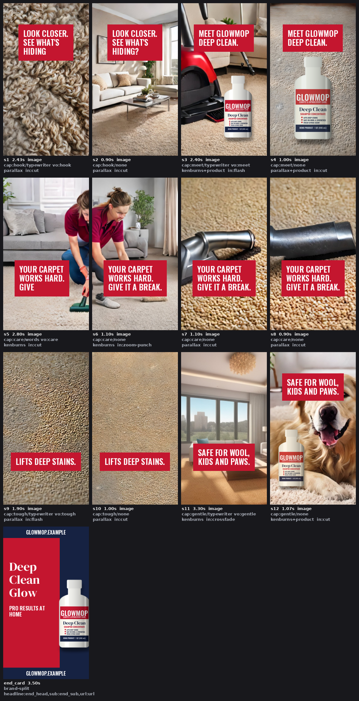

# Demo: a 20-second vertical carpet-cleaner ad (fictional brand)

This example follows the structure of a typical social product ad:
- 12 quick cuts on the beat;
- red caption boxes that type on;
- the product in several shots;
- a short voiceover over a music bed;
- a split brand end card.

Everything in this folder is safe to publish. The brand **GLOWMOP** is invented.



```bash
python reel_cli.py storyboard examples/mimic/mimic.reel.json -o out/mimic_sb.png   # ~2 s
python reel_cli.py render     examples/mimic/mimic.reel.json --name glowmop-mimic   # ~3.5 min on an Intel Iris Xe laptop
```

`preview.mp4` is a downscaled copy of the full render.

## Where each asset came from

| asset | made by | notes |
|---|---|---|
| `glowmop_bottle.png` | `make_product.py`: drawn procedurally (numpy + Pillow, bundled OFL fonts) | no image model, so the label text is exact |
| `music.mp3` | `make_music.py`: synthesized (numpy), 110 BPM | royalty-free by construction |
| `shots/*.jpg` | FastSD CPU (SD-Turbo) via `studio.generate_image`, then `studio.upscale_image` (2x, EDSR) | SD-Turbo output is under the Stability AI Community License (see `THIRD_PARTY_NOTICES.md`) |
| `copy.json` | written for this demo | every caption and voiceover line comes from it by id |
| voiceover | Piper `en_US-ljspeech-medium` at render time | needs `install.py --with reel` |

## What it shows, and what it can't do

- **It shows:**
  - beat-snapped cuts;
  - parallax and Ken Burns motion on stills;
  - exact typewriter captions;
  - product compositing with contact shadows;
  - voiceover ducking the music;
  - the end card;
  - the collision rule that keeps captions off the product (shot 12's caption had to move to the top).
- **It can't:** show real motion of people. The cleaner shots are stills with camera moves, because
  local AI video needs an NVIDIA GPU. A shot's `source` can be `{"video": "clip.mp4"}`, so clips from any
  video generator drop straight into the same shot list.
- **Prompting tip:** generate scenes at `square`. SD-Turbo is trained at 512x512, and tall sizes often
  duplicate the subject.
